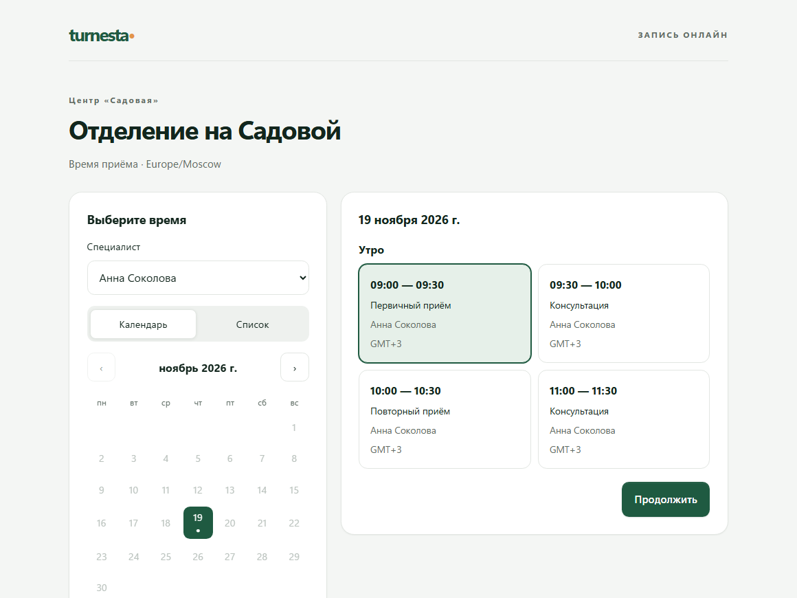
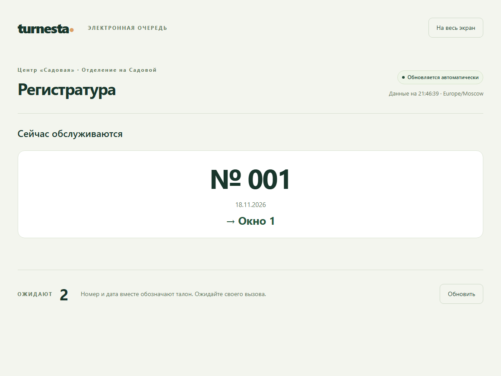
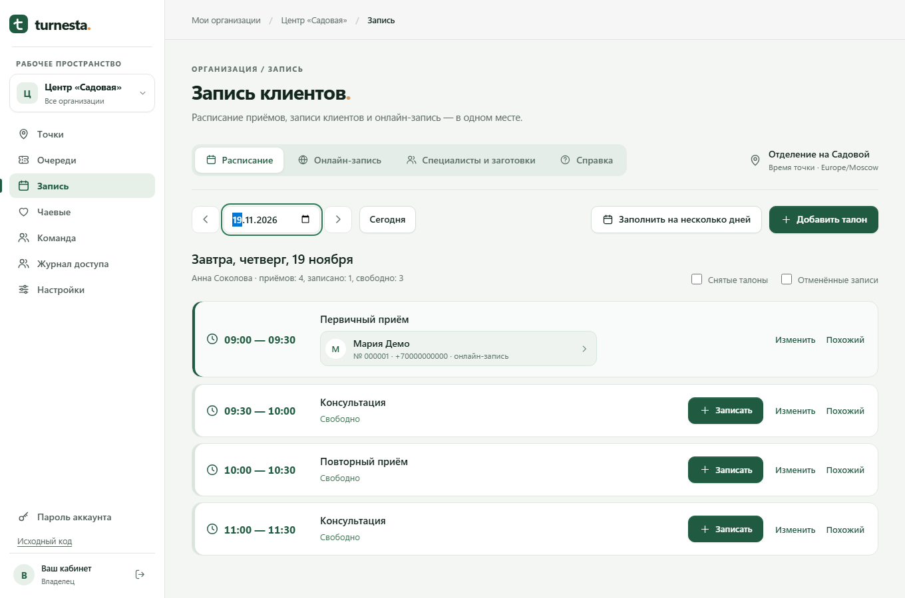
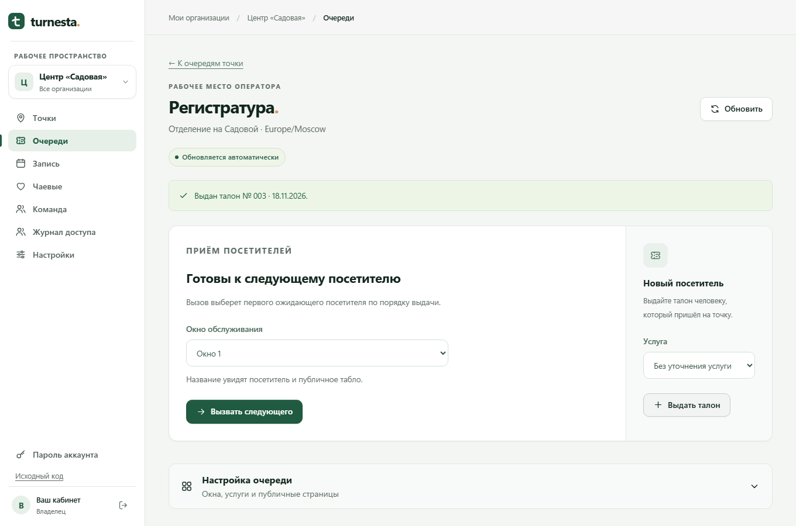

# Turnesta — self-hosted appointment booking and queue management

[Русский](README.ru.md) · [Product tour](https://timeofanarchy.github.io/turnesta/) · [Try locally](#try-locally) · [v0.1.0 pre-release](https://github.com/TimeOfAnarchy/turnesta/releases/tag/v0.1.0)

Turnesta is open-source software for service businesses that take appointments and serve walk-ins. Visitors can book a time on your website or scan a QR code at the counter to join a queue. Staff manage both from one workspace. You run Turnesta on your own server. The application interface is in Russian.

| Online appointments | Walk-in queues |
| --- | --- |
| [](https://timeofanarchy.github.io/turnesta/#bookings) | [](https://timeofanarchy.github.io/turnesta/#queues) |
| Publish a booking page or embed the widget. Visitors choose a time and receive a confirmation number. Staff can also book by hand, move or cancel appointments. | Visitors take a ticket by link or QR code. The operator calls the next person in line. Their ticket and the display board show which service window to go to. |

<details>
<summary>See the staff schedule and queue operator workspace</summary>

| Staff schedule | Queue operator |
| --- | --- |
| [](https://timeofanarchy.github.io/turnesta/#view-schedule) | [](https://timeofanarchy.github.io/turnesta/#view-operator) |

</details>

[Follow both visits through seven screenshots](https://timeofanarchy.github.io/turnesta/#bookings), captured from v0.1.0 with synthetic data.

Owners can set up multiple locations, invite staff and assign roles. The optional Tips module simulates checkout and callbacks. Real charges and payouts are unavailable.

**Release status.** [v0.1.0](https://github.com/TimeOfAnarchy/turnesta/releases/tag/v0.1.0) is a pre-release for evaluation. Staff handle booking changes and cancellations. Booking holds and reminders are unavailable. Local integration checks have passed. Deployment to a real VPS, delivery through external SMTP and integration with a business website still need verification.

## Try locally

Install Git and Docker with the Compose plugin. Run these commands in a POSIX shell; on Windows use Git Bash and Docker Desktop with Linux containers.

```sh
git clone --branch v0.1.0 https://github.com/TimeOfAnarchy/turnesta.git
cd turnesta
./scripts/install.sh
```

The installer builds the application, creates the first organization/owner and prints the sign-in address and temporary password. Set a personal password on first sign-in, then follow [first configuration](docs/GETTING-STARTED.md).

Local mode binds to loopback and uses development database credentials. Its included [MailHog inbox](http://127.0.0.1:8025) captures email without sending it externally. Ports and restart behavior are covered in [deployment](docs/DEPLOYMENT.md#local-evaluation).

## Run on a Linux server

In a fresh server checkout with Docker, Compose, Buildx, flock, curl and a configured domain, run:

```sh
./scripts/install.sh --server
```

The server uses a prebuilt Linux AMD64 image, PostgreSQL and Caddy for HTTPS. The mail worker is optional. The [release notes](https://github.com/TimeOfAnarchy/turnesta/releases/tag/v0.1.0) give the image digest for this version. Follow the [deployment guide](docs/DEPLOYMENT.md#linux-vps) for prerequisites, email and first acceptance, then the [operations runbook](docs/OPERATIONS.md) for updates, backups and recovery.

## Documentation

| Task | Guide |
| --- | --- |
| Find the right instructions | [Documentation index](docs/INDEX.md) |
| Configure a business and staff | [First configuration](docs/GETTING-STARTED.md) |
| Install locally or on a VPS | [Deployment](docs/DEPLOYMENT.md) |
| Update, back up or restore | [Operations](docs/OPERATIONS.md) |
| Embed booking on a website | [Booking widget](docs/BOOKINGS-WIDGET.md) |
| Build, test and contribute | [Development](docs/DEVELOPMENT.md) |
| Understand the implementation | [Architecture](docs/ARCHITECTURE.md) |

Built with Rust, Axum, Tokio, SQLx, PostgreSQL, React, TypeScript and Vite.

[Security policy](SECURITY.md) · [Changelog](CHANGELOG.md) · [AGPL-3.0 license](LICENSE)
