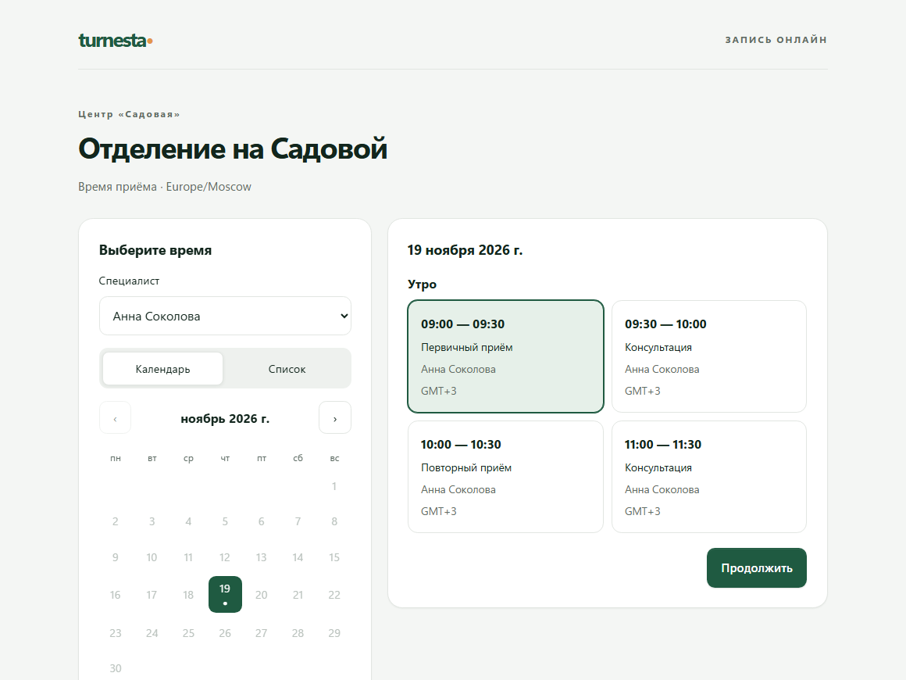
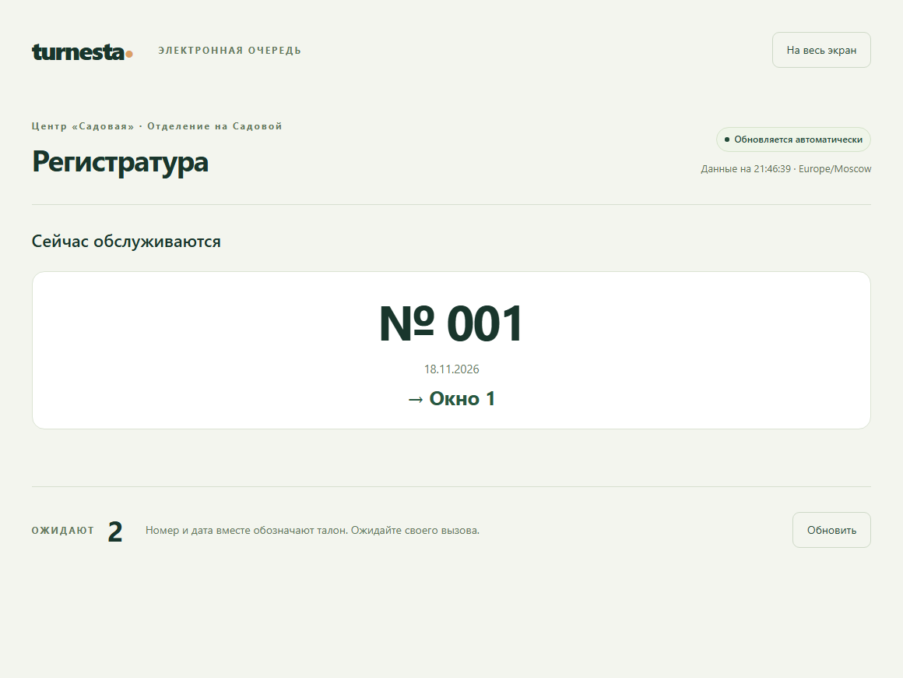
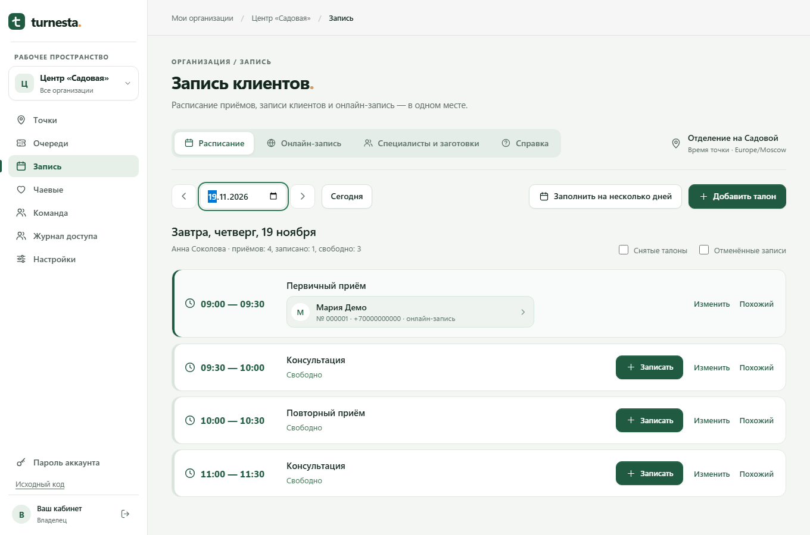
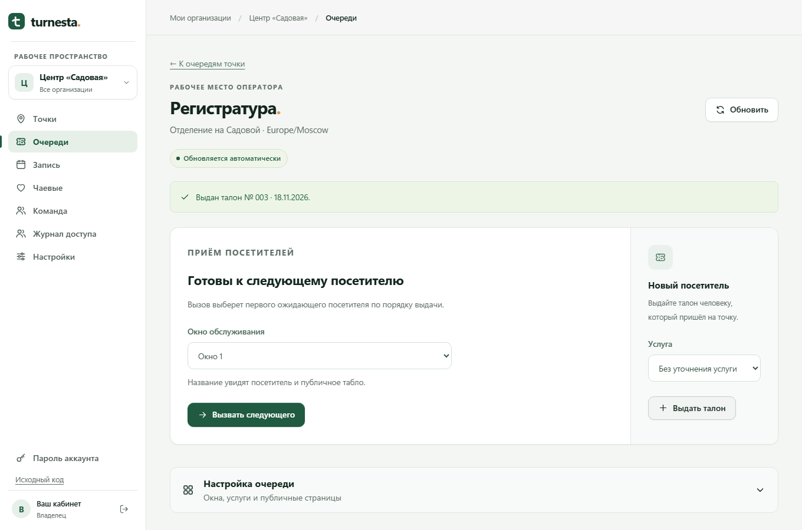

# Turnesta — онлайн-запись и электронная очередь на своём сервере

[English](README.md) · [Обзор со скриншотами](https://timeofanarchy.github.io/turnesta/ru/) · [Локальный запуск](#локальный-запуск) · [Предварительный релиз v0.1.0](https://github.com/TimeOfAnarchy/turnesta/releases/tag/v0.1.0)

Turnesta подходит для организаций, где одни посетители записываются заранее, а другие приходят в порядке живой очереди. Клиент выбирает время на сайте или сканирует QR-код у стойки и получает талон. Сотрудники ведут расписание и вызывают посетителей в одном кабинете. Приложение устанавливается на вашем сервере, интерфейс на русском языке.

| Онлайн-запись | Электронная очередь |
| --- | --- |
| [](https://timeofanarchy.github.io/turnesta/ru/#bookings) | [](https://timeofanarchy.github.io/turnesta/ru/#queues) |
| Разместите ссылку на запись или встройте виджет в свой сайт. Клиент выбирает специалиста и время, заполняет анкету и получает номер подтверждения. Сотрудник может записать клиента вручную, перенести или отменить запись. | Посетитель берёт талон по ссылке или QR-коду. Оператор вызывает следующего и указывает окно обслуживания. Номер талона и окно появляются на табло, вызов виден и на телефоне посетителя. |

<details>
<summary>Посмотреть расписание и рабочее место оператора</summary>

| Расписание специалиста | Рабочее место оператора |
| --- | --- |
| [](https://timeofanarchy.github.io/turnesta/ru/#view-schedule) | [](https://timeofanarchy.github.io/turnesta/ru/#view-operator) |

</details>

[Посмотреть оба сценария](https://timeofanarchy.github.io/turnesta/ru/#bookings) можно без установки. Семь экранов сняты на v0.1.0 с демонстрационными данными.

В организации можно создать несколько точек и назначить сотрудникам роли. Для чаевых есть отдельный тестовый режим с имитацией оплаты. Реальные списания и выплаты недоступны.

**Статус версии.** [v0.1.0](https://github.com/TimeOfAnarchy/turnesta/releases/tag/v0.1.0) — предварительный релиз для знакомства с приложением. Перенос и отмену записи оформляет сотрудник. Временное удержание места и напоминания пока не реализованы. Интеграционные проверки выполнены локально. Развёртывание на реальном VPS, доставка писем через внешний SMTP и подключение сайта действующей организации ещё требуют проверки.

## Локальный запуск

Понадобятся Git, Docker с плагином Compose и POSIX-совместимая оболочка. В Windows подойдут Git Bash и Docker Desktop в режиме Linux-контейнеров.

```sh
git clone --branch v0.1.0 https://github.com/TimeOfAnarchy/turnesta.git
cd turnesta
./scripts/install.sh
```

Установщик соберёт приложение, создаст организацию и первого владельца, затем выведет адрес входа и временный пароль. При первом входе задайте свой пароль. Дальше можно [добавить точку, специалиста и расписание](docs/GETTING-STARTED.md).

Локальная установка использует тестовые учётные данные базы и слушает только на loopback-адресе. Письма попадают в [локальный MailHog](http://127.0.0.1:8025).

## Установка на Linux-сервер

На сервере с настроенным доменом понадобятся Docker, Compose, Buildx, flock и curl. В отдельной свежей копии репозитория выполните:

```sh
./scripts/install.sh --server
```

Серверная конфигурация использует готовый образ для Linux AMD64, PostgreSQL и Caddy для HTTPS. Почтовый воркер подключается отдельно. В [описании релиза](https://github.com/TimeOfAnarchy/turnesta/releases/tag/v0.1.0) указан дайджест образа для этой версии.

## Документация

Руководства доступны на английском языке.

| Задача | Руководство |
| --- | --- |
| Выбрать инструкцию | [Оглавление](docs/INDEX.md) |
| Настроить точку и команду | [Первоначальная настройка](docs/GETTING-STARTED.md) |
| Установить локально или на VPS | [Развёртывание](docs/DEPLOYMENT.md) |
| Обновить, создать копию или восстановить данные | [Эксплуатация](docs/OPERATIONS.md) |
| Добавить запись на сайт | [Виджет](docs/BOOKINGS-WIDGET.md) |
| Собрать и протестировать проект | [Разработка](docs/DEVELOPMENT.md) |
| Разобраться в устройстве приложения | [Архитектура](docs/ARCHITECTURE.md) |

Стек проекта — Rust, Axum, Tokio, SQLx, PostgreSQL, React, TypeScript и Vite.

[Безопасность](SECURITY.md) · [История изменений](CHANGELOG.md) · [Лицензия AGPL-3.0](LICENSE)
